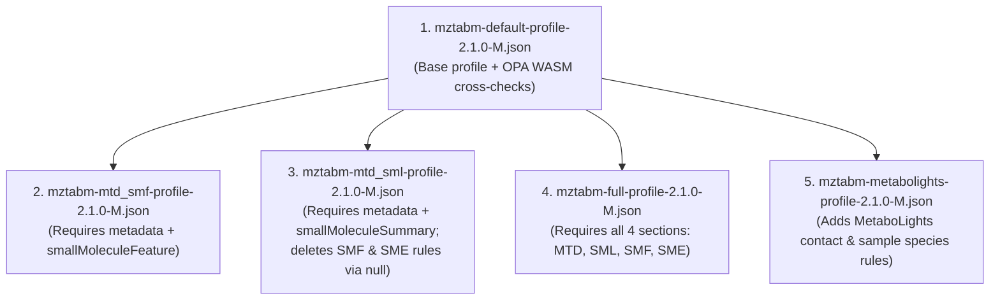

# Tutorial 2: Validating an mzTab-M JSON Dataset Using Different Profiles & OPA WASM

In this tutorial, you will validate a **HUPO-PSI mzTab-M 2.1.0-M** metabolomics reporting file ([`shared/resources/mztab-m/manual_null_MTBLS263.mztab.json`](../resources/mztab-m/manual_null_MTBLS263.mztab.json)) against its canonical JSON Schema ([`mztabm-2.1.0-M.schema.json`](../resources/mztab-m/mztabm-2.1.0-M.schema.json)) and **5 hierarchical profiles** in **Python**, **Java 21**, and **Rust**.

All 3 language implementations (**Python**, **Java 21**, and **Rust**) execute the embedded OPA WebAssembly bundle (`mztabm-default-2.1.0-M.wasm`) natively and are guaranteed to return the **exact same `errors`, `recommendations`, and `optionals`** for every JSONPath (`json_path`) and requirement `code`.

---

## Step 1: Installation & Environment Setup

Run all commands from the repository root (`/path/to/jsonprofile`):

### 1.1 Python (`>= 3.10`)
```sh
cd python
# Includes opa-wasmtime for local OPA WebAssembly evaluation
uv sync --extra opa --group dev
cd ..
```

### 1.2 Java (`JDK 21+` & `Gradle 8.7+`)
```sh
# Includes com.dylibso.chicory:runtime for pure-Java OPA WebAssembly evaluation
gradle --project-cache-dir .cache/gradle/project-cache -p java testClasses
```

### 1.3 Rust (`Cargo 1.75+`)
```sh
# Includes wasmi (default feature "local-opa") for pure-Rust OPA WebAssembly evaluation
cargo build --manifest-path rust/Cargo.toml --tests
```

---

## Step 2: Understand the 5 mzTab-M Profiles & OPA WASM Bundle

All 5 profiles live in [`shared/resources/mztab-m/profiles/`](../resources/mztab-m/profiles/):



### How OPA Policies Are Evaluated Across Languages
The base profile (`mztabm-default-profile-2.1.0-M.json`) declares an OPA WASM bundle in its `"configuration"` and 4 cross-section OPA policy requirements (`D-0010`, `D-0020`, `D-0021`, `D-0022`):

```json
{
  "configuration": {
    "default_wasm_file_key": "default",
    "wasm_file_definitions": {
      "default": {
        "wasm_file_download_url": "https://github.com/HUPO-PSI/mzTab-M/raw/refs/heads/development/mztab_m_io/resources/mztabm-default-2.1.0-M.wasm",
        "wasm_file_path": "../shared/resources/mztab-m/mztabm-default-2.1.0-M.wasm",
        "entrypoint": "mztabm/policies"
      }
    }
  },
  "requirements": {
    "": {
      "description": "MzTabM general cross check rules",
      "enforcement_level": "required",
      "requirements": [
        { "code": "D-0010", "enforcement_level": "required", "policy_id": "policy_d_0010" },
        { "code": "D-0020", "enforcement_level": "required", "policy_id": "policy_d_0020" },
        { "code": "D-0021", "enforcement_level": "required", "policy_id": "policy_d_0021" },
        { "code": "D-0022", "enforcement_level": "required", "policy_id": "policy_d_0022" }
      ]
    }
  }
}
```

When `JsonValidator` evaluates these requirements:
1. `LocalOpaEngineFactory` loads `../shared/resources/mztab-m/mztabm-default-2.1.0-M.wasm` (a `.tar.gz` bundle containing `/policy.wasm` and `/data.json`).
2. `LocalOpaEngine` instantiates `policy.wasm` using the **OPA WebAssembly ABI v1.2**:
   - **Python**: via `wasmtime` (`opa-wasmtime`)
   - **Java 21**: via `com.dylibso.chicory:runtime` (pure-Java WebAssembly runtime)
   - **Rust**: via `wasmi` (pure-Rust WebAssembly interpreter)
3. `LocalOpaEngine` injects `/data.json` via `set_data()` and executes the `mztabm/policies` entrypoint with all 7 OPA built-in functions (`sprintf`, `time.now_ns`, `time.format`, `time.parse_ns`, `regex.find_n`, `regex.replace`, `json.match_schema`).

---

## Step 3: Implement Multi-Profile Validation in 3 Languages

### 3.1 Python Implementation

See [`python/tests/test_mztabm_profile.py`](../../python/tests/test_mztabm_profile.py):

```python
import pathlib
import orjson
from jsonprofile.profile.base import ValidationRuntimeConfiguration
from jsonprofile.validator import JsonValidator

DEFAULT_PROFILE_ID = "https://github.com/HUPO-PSI/mzTab-M/tree/main/schema/profiles/mztabm-default-profile-2.1.0-M.json"
MTD_SMF_PROFILE_ID = "https://github.com/HUPO-PSI/mzTab-M/tree/main/schema/profiles/mztabm-mtd_smf-profile-2.1.0-M.json"
MTD_SML_PROFILE_ID = "https://github.com/HUPO-PSI/mzTab-M/tree/main/schema/profiles/mztabm-mtd_sml-profile-2.1.0-M.json"
FULL_PROFILE_ID = "https://github.com/HUPO-PSI/mzTab-M/tree/main/schema/profiles/mztabm-full-profile-2.1.0-M.json"
METABOLIGHTS_PROFILE_ID = "https://github.com/HUPO-PSI/mzTab-M/tree/main/schema/profiles/mztabm-metabolights-profile-2.1.0-M.json"

PROFILES_PATH = "../shared/resources/mztab-m/profiles"
referenced_profiles = {
    DEFAULT_PROFILE_ID: f"{PROFILES_PATH}/mztabm-default-profile-2.1.0-M.json",
    MTD_SMF_PROFILE_ID: f"{PROFILES_PATH}/mztabm-mtd_smf-profile-2.1.0-M.json",
    MTD_SML_PROFILE_ID: f"{PROFILES_PATH}/mztabm-mtd_sml-profile-2.1.0-M.json",
    FULL_PROFILE_ID: f"{PROFILES_PATH}/mztabm-full-profile-2.1.0-M.json",
    METABOLIGHTS_PROFILE_ID: f"{PROFILES_PATH}/mztabm-metabolights-profile-2.1.0-M.json",
}

schema_path = "../shared/resources/mztab-m/mztabm-2.1.0-M.schema.json"
input_data = orjson.loads(
    pathlib.Path("../shared/resources/mztab-m/manual_null_MTBLS263.mztab.json").read_bytes()
)
runtime_config = ValidationRuntimeConfiguration(offline_mode=True)

for profile_id, profile_path in referenced_profiles.items():
    validator = JsonValidator(
        json_schema=schema_path,
        profile=profile_path,
        referenced_profiles=referenced_profiles,
    )
    result = validator.validate_dict(input_data, runtime_config=runtime_config)
    print(f"=== {validator.json_profile.name} ({profile_id}) ===")
    print(f"Errors ({len(result.errors)} paths):")
    for path, msgs in sorted(result.errors.items()):
        for msg in msgs:
            print(f"  [REQUIRED]    {msg.code}\t{path}\t{msg.message}")
    print(f"Recommendations ({len(result.recommendations)} paths):")
    for path, msgs in sorted(result.recommendations.items()):
        for msg in msgs:
            print(f"  [RECOMMENDED] {msg.code}\t{path}\t{msg.message}")
    print(f"Optionals ({len(result.optionals)} paths):")
    for path, msgs in sorted(result.optionals.items()):
        for msg in msgs:
            print(f"  [OPTIONAL]    {msg.code}\t{path}\t{msg.message}")
```

### 3.2 Java 21 Implementation

See [`java/src/test/java/org/metabolomicshub/jsonprofile/ConformanceSmokeTest.java`](../../java/src/test/java/org/metabolomicshub/jsonprofile/ConformanceSmokeTest.java):

```java
import java.nio.file.Path;
import java.util.List;
import java.util.Map;
import java.util.TreeMap;
import org.metabolomicshub.jsonprofile.profile.JsonProfileMessage;
import org.metabolomicshub.jsonprofile.profile.ValidationRuntimeConfiguration;
import org.metabolomicshub.jsonprofile.validator.JsonValidationResult;
import org.metabolomicshub.jsonprofile.validator.JsonValidator;

public class MzTabMTutorial {
    public static void main(String[] args) {
        Path mztabDir = Path.of("../shared/resources/mztab-m");
        Path profilesDir = mztabDir.resolve("profiles");
        Path schemaPath = mztabDir.resolve("mztabm-2.1.0-M.schema.json");
        Path inputJsonPath = mztabDir.resolve("manual_null_MTBLS263.mztab.json");

        String defaultId = "https://github.com/HUPO-PSI/mzTab-M/tree/main/schema/profiles/mztabm-default-profile-2.1.0-M.json";
        String mtdSmfId = "https://github.com/HUPO-PSI/mzTab-M/tree/main/schema/profiles/mztabm-mtd_smf-profile-2.1.0-M.json";
        String mtdSmlId = "https://github.com/HUPO-PSI/mzTab-M/tree/main/schema/profiles/mztabm-mtd_sml-profile-2.1.0-M.json";
        String fullId = "https://github.com/HUPO-PSI/mzTab-M/tree/main/schema/profiles/mztabm-full-profile-2.1.0-M.json";
        String mtblsId = "https://github.com/HUPO-PSI/mzTab-M/tree/main/schema/profiles/mztabm-metabolights-profile-2.1.0-M.json";

        Map<String, Object> referenced = Map.of(
                defaultId, profilesDir.resolve("mztabm-default-profile-2.1.0-M.json"),
                mtdSmfId, profilesDir.resolve("mztabm-mtd_smf-profile-2.1.0-M.json"),
                mtdSmlId, profilesDir.resolve("mztabm-mtd_sml-profile-2.1.0-M.json"),
                fullId, profilesDir.resolve("mztabm-full-profile-2.1.0-M.json"),
                mtblsId, profilesDir.resolve("mztabm-metabolights-profile-2.1.0-M.json"));

        ValidationRuntimeConfiguration rt = new ValidationRuntimeConfiguration();
        rt.setOfflineMode(true);

        for (String profileId : List.of(defaultId, mtdSmfId, fullId, mtdSmlId, mtblsId)) {
            Path profilePath = (Path) referenced.get(profileId);
            JsonValidator validator = new JsonValidator(schemaPath, profilePath, referenced);
            JsonValidationResult res = validator.validateJsonFile(inputJsonPath, rt);

            System.out.printf("=== %s (%s) ===%n", validator.getJsonProfile().getName(), profileId);
            System.out.printf("Errors (%d paths):%n", res.getErrors().size());
            for (var entry : new TreeMap<>(res.getErrors()).entrySet()) {
                for (JsonProfileMessage msg : entry.getValue()) {
                    System.out.printf("  [REQUIRED]    %s\t%s\t%s%n",
                            msg.getCode(), entry.getKey(), msg.getMessage());
                }
            }
            System.out.printf("Recommendations (%d paths):%n", res.getRecommendations().size());
            for (var entry : new TreeMap<>(res.getRecommendations()).entrySet()) {
                for (JsonProfileMessage msg : entry.getValue()) {
                    System.out.printf("  [RECOMMENDED] %s\t%s\t%s%n",
                            msg.getCode(), entry.getKey(), msg.getMessage());
                }
            }
            System.out.printf("Optionals (%d paths):%n", res.getOptionals().size());
            for (var entry : new TreeMap<>(res.getOptionals()).entrySet()) {
                for (JsonProfileMessage msg : entry.getValue()) {
                    System.out.printf("  [OPTIONAL]    %s\t%s\t%s%n",
                            msg.getCode(), entry.getKey(), msg.getMessage());
                }
            }
        }
    }
}
```

### 3.3 Rust Implementation

See [`rust/tests/conformance_test.rs`](../../rust/tests/conformance_test.rs):

```rust
use jsonprofile::{JsonValidator, ProfileSource, ValidationRuntimeConfiguration};
use std::collections::HashMap;
use std::path::PathBuf;

fn main() -> Result<(), String> {
    let mztab_dir = PathBuf::from("../shared/resources/mztab-m");
    let profiles_dir = mztab_dir.join("profiles");
    let schema_path = mztab_dir.join("mztabm-2.1.0-M.schema.json");
    let input_json_path = mztab_dir.join("manual_null_MTBLS263.mztab.json");

    let default_id = "https://github.com/HUPO-PSI/mzTab-M/tree/main/schema/profiles/mztabm-default-profile-2.1.0-M.json";
    let mtd_smf_id = "https://github.com/HUPO-PSI/mzTab-M/tree/main/schema/profiles/mztabm-mtd_smf-profile-2.1.0-M.json";
    let mtd_sml_id = "https://github.com/HUPO-PSI/mzTab-M/tree/main/schema/profiles/mztabm-mtd_sml-profile-2.1.0-M.json";
    let full_id = "https://github.com/HUPO-PSI/mzTab-M/tree/main/schema/profiles/mztabm-full-profile-2.1.0-M.json";
    let mtbls_id = "https://github.com/HUPO-PSI/mzTab-M/tree/main/schema/profiles/mztabm-metabolights-profile-2.1.0-M.json";

    let mut refs: HashMap<String, ProfileSource> = HashMap::new();
    refs.insert(default_id.to_string(), ProfileSource::Path(profiles_dir.join("mztabm-default-profile-2.1.0-M.json")));
    refs.insert(mtd_smf_id.to_string(), ProfileSource::Path(profiles_dir.join("mztabm-mtd_smf-profile-2.1.0-M.json")));
    refs.insert(mtd_sml_id.to_string(), ProfileSource::Path(profiles_dir.join("mztabm-mtd_sml-profile-2.1.0-M.json")));
    refs.insert(full_id.to_string(), ProfileSource::Path(profiles_dir.join("mztabm-full-profile-2.1.0-M.json")));
    refs.insert(mtbls_id.to_string(), ProfileSource::Path(profiles_dir.join("mztabm-metabolights-profile-2.1.0-M.json")));

    let rt = ValidationRuntimeConfiguration {
        offline_mode: Some(true),
        ..Default::default()
    };

    for profile_id in [default_id, mtd_smf_id, full_id, mtd_sml_id, mtbls_id] {
        let ProfileSource::Path(profile_path) = refs.get(profile_id).unwrap().clone() else {
            unreachable!()
        };
        let validator = JsonValidator::with_referenced_profiles(
            Some(ProfileSource::Path(schema_path.clone())),
            ProfileSource::Path(profile_path),
            refs.clone(),
        )?;
        let res = validator.validate_json_file(&input_json_path, Some(rt.clone()))?;

        println!("=== {} ({}) ===", validator.json_profile.name, profile_id);
        println!("Errors ({} paths):", res.errors.len());
        for (path, msgs) in &res.errors {
            for msg in msgs {
                println!("  [REQUIRED]    {}\t{}\t{}", msg.code, path, msg.message);
            }
        }
        println!("Recommendations ({} paths):", res.recommendations.len());
        for (path, msgs) in &res.recommendations {
            for msg in msgs {
                println!("  [RECOMMENDED] {}\t{}\t{}", msg.code, path, msg.message);
            }
        }
        println!("Optionals ({} paths):", res.optionals.len());
        for (path, msgs) in &res.optionals {
            for msg in msgs {
                println!("  [OPTIONAL]    {}\t{}\t{}", msg.code, path, msg.message);
            }
        }
    }
    Ok(())
}
```

---

## Step 4: Run Steps & Example Validation Outputs Across All 5 Profiles

Run the mzTab-M validation tests in any of the 3 languages from the repository root:

```sh
# 1. Python
cd python && PYTHONPATH=. uv run pytest tests/test_mztabm_profile.py -v -s && cd ..

# 2. Java 21
gradle --project-cache-dir .cache/gradle/project-cache -p java test --tests org.metabolomicshub.jsonprofile.ConformanceSmokeTest.validatesMzTabMProfilesOffline --info

# 3. Rust
cargo test --manifest-path rust/Cargo.toml --test conformance_test test_mztab_m_profiles -- --nocapture
```

### 4.1 Profiles 1, 2, and 3: `default`, `mtd_smf`, and `full`

In `manual_null_MTBLS263.mztab.json`:
- JSON Schema Draft-07 validation passes (`0` schema errors).
- All 4 OPA WASM cross-check policies (`D-0010`, `D-0020`, `D-0021`, `D-0022` in `mztabm-default-2.1.0-M.wasm`) pass (`0` OPA errors).
- `smallMoleculeFeature[81..90].charge` and `smallMoleculeEvidence[81..90].charge` have value `-1` while `D-SMF-CHARGE-0001` and `D-SME-CHARGE-0001` define `positive-integer` (`minimum: 1`). The per-requirement circuit breaker (`max_messages_for_each_requirement = 10`) caps each rule at 10 messages in document order (`[81]..[90]`).
- For `recommendations`, `D-MTD-CONTACT-0001`, `D-MTD-MS_RUN-0040` (capped at 10 runs `[1]..[10]`), and `D-MTD-SAMPLE-0020` emit **12 recommendation paths**.

All 3 implementations (**Python**, **Java 21**, and **Rust**) produce the **exact same 20 `errors` paths, 12 `recommendations` paths, and 0 `optionals` paths**:

```text
=== mzTab-M 2.1.0-M Default Profile (https://github.com/HUPO-PSI/mzTab-M/tree/main/schema/profiles/mztabm-default-profile-2.1.0-M.json) ===
Errors (20 paths):
  [REQUIRED]    D-SME-CHARGE-0001	$.smallMoleculeEvidence[81].charge	minimum value error. current: -1, min: 1
  [REQUIRED]    D-SME-CHARGE-0001	$.smallMoleculeEvidence[82].charge	minimum value error. current: -1, min: 1
  [REQUIRED]    D-SME-CHARGE-0001	$.smallMoleculeEvidence[83].charge	minimum value error. current: -1, min: 1
  [REQUIRED]    D-SME-CHARGE-0001	$.smallMoleculeEvidence[84].charge	minimum value error. current: -1, min: 1
  [REQUIRED]    D-SME-CHARGE-0001	$.smallMoleculeEvidence[85].charge	minimum value error. current: -1, min: 1
  [REQUIRED]    D-SME-CHARGE-0001	$.smallMoleculeEvidence[86].charge	minimum value error. current: -1, min: 1
  [REQUIRED]    D-SME-CHARGE-0001	$.smallMoleculeEvidence[87].charge	minimum value error. current: -1, min: 1
  [REQUIRED]    D-SME-CHARGE-0001	$.smallMoleculeEvidence[88].charge	minimum value error. current: -1, min: 1
  [REQUIRED]    D-SME-CHARGE-0001	$.smallMoleculeEvidence[89].charge	minimum value error. current: -1, min: 1
  [REQUIRED]    D-SME-CHARGE-0001	$.smallMoleculeEvidence[90].charge	minimum value error. current: -1, min: 1
  [REQUIRED]    D-SMF-CHARGE-0001	$.smallMoleculeFeature[81].charge	minimum value error. current: -1, min: 1
  [REQUIRED]    D-SMF-CHARGE-0001	$.smallMoleculeFeature[82].charge	minimum value error. current: -1, min: 1
  [REQUIRED]    D-SMF-CHARGE-0001	$.smallMoleculeFeature[83].charge	minimum value error. current: -1, min: 1
  [REQUIRED]    D-SMF-CHARGE-0001	$.smallMoleculeFeature[84].charge	minimum value error. current: -1, min: 1
  [REQUIRED]    D-SMF-CHARGE-0001	$.smallMoleculeFeature[85].charge	minimum value error. current: -1, min: 1
  [REQUIRED]    D-SMF-CHARGE-0001	$.smallMoleculeFeature[86].charge	minimum value error. current: -1, min: 1
  [REQUIRED]    D-SMF-CHARGE-0001	$.smallMoleculeFeature[87].charge	minimum value error. current: -1, min: 1
  [REQUIRED]    D-SMF-CHARGE-0001	$.smallMoleculeFeature[88].charge	minimum value error. current: -1, min: 1
  [REQUIRED]    D-SMF-CHARGE-0001	$.smallMoleculeFeature[89].charge	minimum value error. current: -1, min: 1
  [REQUIRED]    D-SMF-CHARGE-0001	$.smallMoleculeFeature[90].charge	minimum value error. current: -1, min: 1
Recommendations (12 paths):
  [RECOMMENDED] D-MTD-CONTACT-0001	$.metadata.contact	minimum count error: current: 0, min: 1
  [RECOMMENDED] D-MTD-MS_RUN-0040	$.metadata.ms_run[1].instrument_ref	value is null
  [RECOMMENDED] D-MTD-MS_RUN-0040	$.metadata.ms_run[2].instrument_ref	value is null
  [RECOMMENDED] D-MTD-MS_RUN-0040	$.metadata.ms_run[3].instrument_ref	value is null
  [RECOMMENDED] D-MTD-MS_RUN-0040	$.metadata.ms_run[4].instrument_ref	value is null
  [RECOMMENDED] D-MTD-MS_RUN-0040	$.metadata.ms_run[5].instrument_ref	value is null
  [RECOMMENDED] D-MTD-MS_RUN-0040	$.metadata.ms_run[6].instrument_ref	value is null
  [RECOMMENDED] D-MTD-MS_RUN-0040	$.metadata.ms_run[7].instrument_ref	value is null
  [RECOMMENDED] D-MTD-MS_RUN-0040	$.metadata.ms_run[8].instrument_ref	value is null
  [RECOMMENDED] D-MTD-MS_RUN-0040	$.metadata.ms_run[9].instrument_ref	value is null
  [RECOMMENDED] D-MTD-MS_RUN-0040	$.metadata.ms_run[10].instrument_ref	value is null
  [RECOMMENDED] D-MTD-SAMPLE-0020	$.metadata.sample[0].species[0]	'[BTO, BTO:0000089, blood, ]' not in the selected cv list: NCBITAXON, ENVO, CHEBI
Optionals (0 paths):
```

### 4.2 Profile 4: `mztabm-mtd_sml-profile-2.1.0-M.json` (Summary-Only Profile)

`mztabm-mtd_sml-profile-2.1.0-M.json` extends `default`, requires only `metadata` and `smallMoleculeSummary`, and deletes all `$.smallMoleculeFeature[*].*` and `$.smallMoleculeEvidence[*].*` requirements by setting them to `null`.

All 3 implementations (**Python**, **Java 21**, and **Rust**) return **0 `errors` paths, 12 `recommendations` paths, and 0 `optionals` paths**:

```text
=== mzTab-M 2.1.0-M File Profile with summary section (https://github.com/HUPO-PSI/mzTab-M/tree/main/schema/profiles/mztabm-mtd_sml-profile-2.1.0-M.json) ===
Errors (0 paths):
Recommendations (12 paths):
  [RECOMMENDED] D-MTD-CONTACT-0001	$.metadata.contact	minimum count error: current: 0, min: 1
  [RECOMMENDED] D-MTD-MS_RUN-0040	$.metadata.ms_run[1].instrument_ref	value is null
  [RECOMMENDED] D-MTD-MS_RUN-0040	$.metadata.ms_run[2].instrument_ref	value is null
  [RECOMMENDED] D-MTD-MS_RUN-0040	$.metadata.ms_run[3].instrument_ref	value is null
  [RECOMMENDED] D-MTD-MS_RUN-0040	$.metadata.ms_run[4].instrument_ref	value is null
  [RECOMMENDED] D-MTD-MS_RUN-0040	$.metadata.ms_run[5].instrument_ref	value is null
  [RECOMMENDED] D-MTD-MS_RUN-0040	$.metadata.ms_run[6].instrument_ref	value is null
  [RECOMMENDED] D-MTD-MS_RUN-0040	$.metadata.ms_run[7].instrument_ref	value is null
  [RECOMMENDED] D-MTD-MS_RUN-0040	$.metadata.ms_run[8].instrument_ref	value is null
  [RECOMMENDED] D-MTD-MS_RUN-0040	$.metadata.ms_run[9].instrument_ref	value is null
  [RECOMMENDED] D-MTD-MS_RUN-0040	$.metadata.ms_run[10].instrument_ref	value is null
  [RECOMMENDED] D-MTD-SAMPLE-0020	$.metadata.sample[0].species[0]	'[BTO, BTO:0000089, blood, ]' not in the selected cv list: NCBITAXON, ENVO, CHEBI
Optionals (0 paths):
```

### 4.3 Profile 5: `mztabm-metabolights-profile-2.1.0-M.json` (MetaboLights Submissions Profile)

`mztabm-metabolights-profile-2.1.0-M.json` extends `default`, relaxes `charge` to allow negative integers (`integer` constraint instead of `positive-integer`), removes `$.metadata.ms_run[*].instrument_ref`, and promotes `$.metadata.contact` (`MTBLS-METADATA-CONTACT-0001`) and `$.metadata.sample[*].species[*]` (`MTBLS-METADATA-SAMPLE-0031`) from `recommended` to `required`.

All 3 implementations (**Python**, **Java 21**, and **Rust**) return **2 `errors` paths, 0 `recommendations` paths, and 0 `optionals` paths**:

```text
=== mzTab-M 2.1.0-M Profile for MetaboLights Submissions (https://github.com/HUPO-PSI/mzTab-M/tree/main/schema/profiles/mztabm-metabolights-profile-2.1.0-M.json) ===
Errors (2 paths):
  [REQUIRED]    MTBLS-METADATA-CONTACT-0001	$.metadata.contact	minimum count error: current: 0, min: 1
  [REQUIRED]    MTBLS-METADATA-SAMPLE-0031	$.metadata.sample[0].species[0]	'[BTO, BTO:0000089, blood, ]' not in the selected cv list: NCBITAXON, ENVO, CHEBI
Recommendations (0 paths):
Optionals (0 paths):
```

---

## Step 5: Cross-Language Parity Summary Table

| Profile | `errors` (`REQUIRED`) | `recommendations` (`RECOMMENDED`) | `optionals` (`OPTIONAL`) |
| :--- | :--- | :--- | :--- |
| **`default`** | **20 paths**: `$.smallMoleculeEvidence[81..90].charge` (`D-SME-CHARGE-0001`), `$.smallMoleculeFeature[81..90].charge` (`D-SMF-CHARGE-0001`) | **12 paths**: `$.metadata.contact` (`D-MTD-CONTACT-0001`), `$.metadata.ms_run[1..10].instrument_ref` (`D-MTD-MS_RUN-0040`), `$.metadata.sample[0].species[0]` (`D-MTD-SAMPLE-0020`) | **0 paths** |
| **`mtd_smf`** | **20 paths** *(identical to `default`)* | **12 paths** *(identical to `default`)* | **0 paths** |
| **`full`** | **20 paths** *(identical to `default`)* | **12 paths** *(identical to `default`)* | **0 paths** |
| **`mtd_sml`** | **0 paths** (`SUCCESS`) | **12 paths** *(identical to `default`)* | **0 paths** |
| **`metabolights`** | **2 paths**: `$.metadata.contact` (`MTBLS-METADATA-CONTACT-0001`), `$.metadata.sample[0].species[0]` (`MTBLS-METADATA-SAMPLE-0031`) | **0 paths** | **0 paths** |
